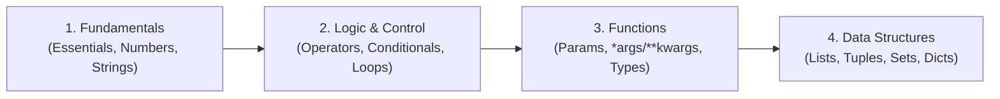

# Python Learning Roadmap & Overview

Welcome to the **HumDev Python Series**. This documentation track is organized into a progressive learning path designed to take you from core language fundamentals to idiomatic data structures and modern Python idioms.

Whether you are revising before technical interviews or looking up specific syntax and method behaviors, every module provides clear explanations, executable code examples, and expected outputs.

---

## 🗺️ Learning Path Structure

The curriculum is structured across four key pedagogical pillars:

---

## 📚 Modules Overview

| Topic | File Reference | Key Concepts Covered |
| :--- | :--- | :--- |
| [**1. Python Essentials**](/python/essentials) | `python_scripts/01_python_essentials.py` | `input()`, `print()`, escape characters (`\t`, `\"`, `\\`), formatted printing, `None` type |
| [**2. Numbers & Arithmetic**](/python/numbers) | `python_scripts/04_numbers_python.py` | Type casting, `/` vs `//`, `**`, `abs()`, `round()`, `math` module, random numbers, `is_integer()` |
| [**3. Strings & Text Processing**](/python/strings) | `python_scripts/03_strings.py` | `len()`, `count()`, `replace()`, f-strings, slicing `[start:end:step]`, `strip()`, search & validation |
| [**4. Logic & Operators**](/python/operators) | `python_scripts/05_logic_operators.py` | `bool()`, chained comparison (`1 < x < 5`), logical operators (`and`/`or`/`not`), `in`, `is` vs `==` |
| [**5. Conditional Statements**](/python/conditionals) | `python_scripts/06_conditional_statements.py` | `if / elif / else`, ternary inline expressions, structural pattern matching (`match ... case`) |
| [**6. Loops & Iteration**](/python/loops) | `python_scripts/07_loops.py` | `for` loops, `range()` parameters, `break`, `continue`, `pass`, `for...else`, `while` loops |
| [**7. Functions & Scope**](/python/functions) | `python_scripts/02_function.py` | Functions vs methods, parameter shapes, positional vs keyword arguments, `*args`, `**kwargs`, type hints |
| [**8. Lists & Comprehensions**](/python/lists) | `python_scripts/08_python_list.py` | Slicing, unpacking (`*`, `_`), methods (`append`, `pop`, `sort`), shallow vs deepcopy, iterators, comprehensions |
| [**9. Tuples & Sets**](/python/tuples-and-sets) | `python_scripts/09_python_set.py` | Tuple immutability, set uniqueness, mutations (`add`, `remove`, `discard`), union, intersection, difference, subsets |
| [**10. Dictionaries**](/python/dictionaries) | `python_scripts/10_python_dict.py` | Key-value mapping, key immutability, safe `.get()`, view objects (`keys`, `values`, `items`), mutations, `dict.fromkeys` |

---

## 💡 How to Use This Knowledge Base

1. **Sequential Learning**: If you are revising Python, work sequentially through the topics from Topic 1 through Topic 10.
2. **Quick Reference**: Use the left sidebar or the search bar (`Ctrl + K` or `Cmd + K`) to jump directly to any function, method, or syntax rule.
3. **Copy & Run**: All code snippets feature a one-click copy button and provide verified outputs so you can immediately see the result without guesswork.

Ready to begin? Start with [**Topic 01: Python Essentials →**](/python/essentials)
